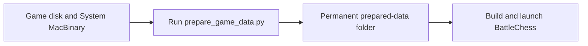

# BattleChess recovery tools

Prepare the original Macintosh game data for the native C/C++/SDL3
[BattleChess](https://github.com/myaumura/BattleChess) port. Supply your own game
disk and System MacBinary; the tools produce a verified folder ready for the game.

## Start here

[Follow the complete preparation and launch guide](docs/PREPARE_DATA.md).
It uses a permanent directory at `~/Games/BattleChess/` and the public repositories:

- [BattleChess-re-tools](https://github.com/myaumura/BattleChess-re-tools): extraction and data preparation.
- [BattleChess](https://github.com/myaumura/BattleChess): the playable native game; [build guide](https://github.com/myaumura/BattleChess/blob/main/docs/BUILD.md), [data contract](https://github.com/myaumura/BattleChess/blob/main/docs/DATA.md) and [roadmap](https://github.com/myaumura/BattleChess/blob/main/docs/ROADMAP.md).



## Prepare data

After installing the [dependencies](docs/DEPENDENCIES.md) and following the guide's
repository and input setup, run:

```sh
BC_ROOT="$HOME/Games/BattleChess"
python3 "$BC_ROOT/repos/BattleChess-re-tools/scripts/prepare_game_data.py" \
  --disk "$BC_ROOT/originals/BattleChess.img" \
  --system "$BC_ROOT/originals/System.bin" \
  --output "$BC_ROOT/data/prepared-data"
```

The output must be a new folder outside source repositories. The command preserves
original files and existing outputs, validates the generated data and publishes
only a complete pack. Keep the pack for later launches.

## Launch BattleChess

With the native build dependencies installed:

```sh
BC_ROOT="$HOME/Games/BattleChess"
export BC_DATA_DIR="$BC_ROOT/data/prepared-data"
"$BC_ROOT/repos/BattleChess/tools/run.sh"
```

The run script builds the application against this pack and launches it. For
installation and troubleshooting, use the [complete guide](docs/PREPARE_DATA.md).

## Scripts for the main BattleChess port

Run [prepare_game_data.py](scripts/prepare_game_data.py) for complete preparation.
It uses [prepare_data.py](tools/recompilation/prepare_data.py) to assemble the pack
and calls the supporting extraction, decoding and validation scripts automatically.
[The linked script inventory](docs/TOOLS.md) describes every helper.

## Reference documentation

- [Reverse-engineering process and diagrams](docs/WORKFLOW.md)
- [Script inventory](docs/TOOLS.md)
- [Dependencies and upstream tools](docs/DEPENDENCIES.md)
- [Historical research and behavior evidence](docs/README.md)
- [License and third-party boundaries](NOTICE)

The supported input is the reference Macintosh Battle Chess 1.0.2 disk described
in the guide. Other builds and Apple II files are incompatible. Original inputs
and generated packs belong outside source repositories and public releases.
Python uses the standard library. Ghidra and Swift staging are not part of this
preparation workflow.

## Contributing

Keep original inputs and generated data outside this repository. Submit source,
synthetic tests and text documentation. Run these checks from this checkout:

```sh
PYTHONDONTWRITEBYTECODE=1 python3 -m unittest discover -s tests -v
python3 scripts/check_publication.py
```

Synthetic tests require no original data. Historical research records describe
prior validation; tests and successful preparation do not establish complete
original Macintosh behavior parity. Authored tools and documentation use the
[MIT license](LICENSE); original and third-party material are outside that license.
