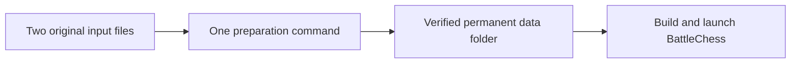

# Prepare data and launch BattleChess

This guide prepares the data for [BattleChess](https://github.com/myaumura/BattleChess),
the native C/C++/SDL3 port. You supply two original files, run one preparation
command and launch the game with the resulting folder.

## Preparation flow



Use this directory layout on macOS or Linux:

```text
~/Games/BattleChess/
  originals/
    BattleChess.img
    System.bin
  repos/
    BattleChess-re-tools/
    BattleChess/
  data/
    prepared-data/
```

The `originals/` and `data/` folders stay outside both Git repositories. The
preparation command creates `data/prepared-data/`; do not create it in advance.
You can use another location by changing `BC_ROOT` in the commands below.

## 1. Install dependencies

Install these before continuing:

| Purpose | Required tools | Installation reference |
|---|---|---|
| Preparation | Python 3.12+, Git, `m68kdasm`, `hmount`, `hcopy`, `humount` | [Dependency guide](DEPENDENCIES.md) |
| Native game | C11/C++17 compiler, CMake 3.20+, SDL3 3.4+ development files | [BattleChess build guide](https://github.com/myaumura/BattleChess/blob/main/docs/BUILD.md) |

`m68kdasm` comes from [resource_dasm releases](https://github.com/fuzziqersoftware/resource_dasm/releases)
or its [source-build instructions](https://github.com/fuzziqersoftware/resource_dasm#building).
The HFS commands come from hfsutils. These commands must be available on `PATH`.

On macOS with Homebrew, install hfsutils with
[`brew install hfsutils`](https://formulae.brew.sh/formula/hfsutils).
The native build guide covers the compiler, CMake and SDL3 installation for macOS
and Linux. The scripts do not install dependencies or download original inputs.

## 2. Get the repositories

```sh
BC_ROOT="$HOME/Games/BattleChess"
mkdir -p "$BC_ROOT/repos" "$BC_ROOT/originals" "$BC_ROOT/data"
git clone https://github.com/myaumura/BattleChess-re-tools.git \
  "$BC_ROOT/repos/BattleChess-re-tools"
git clone https://github.com/myaumura/BattleChess.git \
  "$BC_ROOT/repos/BattleChess"
```

If you already cloned these repositories, use their existing locations instead
of cloning over them.

## 3. Supply the original files

Place your own files at the following addresses:

| Address | Required file |
|---|---|
| `~/Games/BattleChess/originals/BattleChess.img` | The reference Macintosh Battle Chess 1.0.2 HFS game disk. Its root contains `ALLCANM1`, `ALLCANM2`, `Battle Chess` and `Battle Chess Manual`. |
| `~/Games/BattleChess/originals/System.bin` | A System 7 `System` file exported as **MacBinary**, preserving its resource fork and the reference Chicago12, Geneva9 and stop-icon resources. |

A System disk image or a resource-stripped System file is not sufficient. File
extensions do not convert formats. The game-disk reference is 3,670,016 bytes with
SHA-256 `ba1b3758368c032f6f8475e8bebd07db60c8736c12049ee64785f84356d50af5`.
Only this game-disk build is supported; Apple II files are incompatible.

The recorded System MacBinary reference has SHA-256
`21184e30e95a4e5b87a4cdcc44b02202c1fc4784ad04fcb4b5dc3be4156bbcb1`.
Equivalent containers are accepted when their extracted fonts and icon pass the
reference checks. See [font provenance](recovery/SYSTEM_FONTS.md).

## 4. Prepare the data

```sh
BC_ROOT="$HOME/Games/BattleChess"
python3 "$BC_ROOT/repos/BattleChess-re-tools/scripts/prepare_game_data.py" \
  --disk "$BC_ROOT/originals/BattleChess.img" \
  --system "$BC_ROOT/originals/System.bin" \
  --output "$BC_ROOT/data/prepared-data"
```

The command checks the original inputs, decodes the required resources and
verifies the finished pack. It reports the final folder after successful
preparation. Original inputs and existing output folders are preserved; a failed
run does not publish a partial pack. Run one preparation at a time and keep
Python assertions enabled: do not use `-O` or `PYTHONOPTIMIZE`.

You do not need to run extraction scripts individually or supply a separate
application binary, disassembly, recovery model or extracted fonts.

## 5. Launch the game

```sh
BC_ROOT="$HOME/Games/BattleChess"
export BC_DATA_DIR="$BC_ROOT/data/prepared-data"
"$BC_ROOT/repos/BattleChess/tools/run.sh"
```

This command builds the native application against the prepared data and launches
it. Reuse the same command for later launches. Game options can follow the script
name, for example `--flat`.

For an already built matching executable:

```sh
"$BC_ROOT/repos/BattleChess/build/battlechess" \
  --data "$BC_ROOT/data/prepared-data"
```

Keep the entire prepared-data folder together. Its generated headers, animation
pixels, media and checksums belong to the same extraction; see the native
[data contract](https://github.com/myaumura/BattleChess/blob/main/docs/DATA.md).
To regenerate, select a new output folder, update `BC_DATA_DIR` and rerun the
launch script so the application's compiled catalogs match the new pack.

## Troubleshooting

| Problem | Action |
|---|---|
| Missing dependency | Install the named command and ensure it is on `PATH`; see [dependencies](DEPENDENCIES.md). |
| Unsupported game disk | Compare its SHA-256 with the reference above. |
| Invalid System file or font-check failure | Export the System file as MacBinary with its resource fork intact and the reference resources. |
| Output already exists | Reuse the complete pack or choose a new output folder. |
| Output inside a source checkout | Use a separate data folder, as in the layout above. |
| Preparation stage fails | Fix the reported input, dependency or storage problem, then rerun the preparation command. |
| SDL3 or native build failure | Follow the [native build guide](https://github.com/myaumura/BattleChess/blob/main/docs/BUILD.md). |
| Missing runtime media | Point `BC_DATA_DIR` or `--data` at the complete matching pack. |

Generated packs contain original resources and belong outside source repositories
and public releases. Preparation checks do not establish complete original-game
parity; the [native roadmap](https://github.com/myaumura/BattleChess/blob/main/docs/ROADMAP.md)
records remaining behavior and validation gaps.
