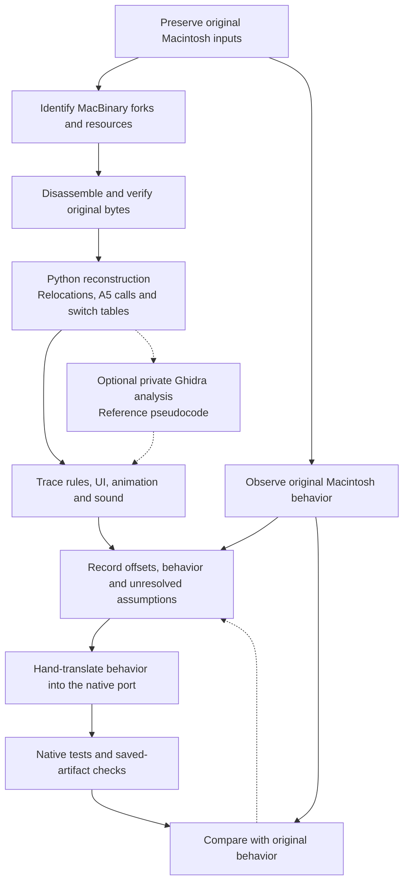
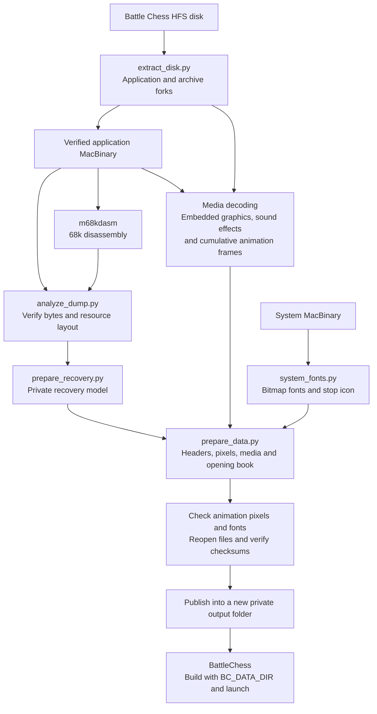

# Reverse-engineering reference

To prepare data and play the native game, use the
[preparation and launch guide](PREPARE_DATA.md). It needs only the game disk and
System MacBinary and runs the entire data pipeline through one command.

This document explains the analysis behind the tools. The diagrams show data and
evidence relationships; their nodes are not additional setup steps for users.
The [script inventory](TOOLS.md) links the implementations, and the
[research index](README.md) retains format notes and original-behavior evidence.

## Reverse-engineering process

Python reconstructs the model used for data generation. Manual behavior recovery
combines verified binary evidence with observations of the original Macintosh
game. Ghidra is an optional private research branch; its exporter is not included
in the public preparation workflow.

The analysis model preserves resource offsets, relocations, A5 calls and switch
tables. Synthetic analysis addresses are not historical RAM addresses. Inferred
names and unresolved behavior remain explicit; reference pseudocode is not
buildable recovered source or proof of equivalence.

The hand-translated implementation lives in
[BattleChess](https://github.com/myaumura/BattleChess). Its
[roadmap](https://github.com/myaumura/BattleChess/blob/main/docs/ROADMAP.md) describes
remaining behavior gaps. Builds, saved-artifact comparisons, original-game
observations and platform testing establish different things.

## Data preparation internals

[prepare_game_data.py](../scripts/prepare_game_data.py) calls the extraction,
analysis, media, font, pack and validation tools automatically. The user receives
only the verified final data folder described in the [launch guide](PREPARE_DATA.md).

No decompiled C is needed to generate the pack. Original resources, decoded
media, analysis models and generated packs remain outside the source repositories.
Swift resource staging belongs to the separate private Swift remake.

## Evidence references

- [Original input layers](recovery/SOURCE_INPUTS.md)
- [68k resources and A5 analysis](recovery/ANALYSIS.md)
- [Code-recovery limitations](recovery/RECOVERY.md)
- [Graphics decoding](recovery/GRAPHICS_FORMAT.md)
- [Audio decoding](recovery/AUDIO_FORMAT.md)
- [System font provenance](recovery/SYSTEM_FONTS.md)
- [Original-runtime observations](recompilation/ORIGINAL_RUNTIME_EVIDENCE.md)
- [Historical recovery progress](recompilation/RECOVERY_PROGRESS.md)

Historical commands and local paths in those records describe the research
workspace used at the time. Use [the final guide](PREPARE_DATA.md) for current
repository addresses, input locations, preparation and launch commands.
